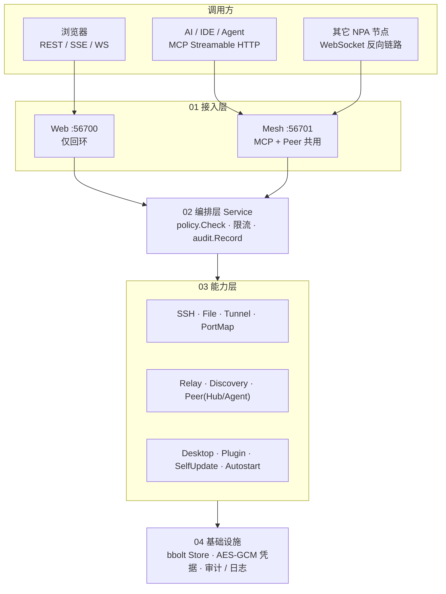
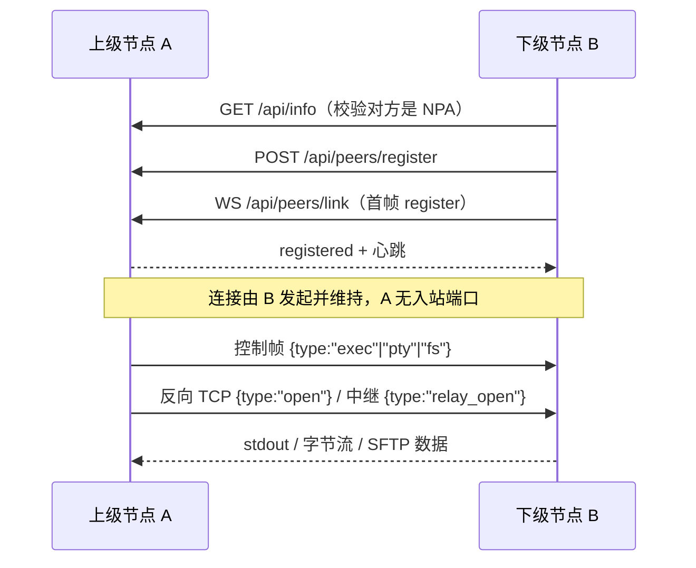

# NPA 架构（实现为准）

> 依据当前工作区源码绘制，非设计文档复述。最后提交 `4fb5dda`，工作区另有未提交改动。
> 配套图：`npa-architecture.png`（分层）、`npa-mesh.png`（反向接入与数据面）、`npa-domain-v2.png`（分域架构 v2：域/管理者/三平面分离设计稿）。
>
> **文档导航**：[① 分层总览](npa-architecture.html) · [② 反向接入/数据面](npa-mesh.html) · [③ 分域 v2 设计](npa-domain-v2.html) · [本页 ARCHITECTURE.md](ARCHITECTURE.md)。各 HTML 页右上角也有同样的悬浮导航，可互相跳转。

## 1. 一句话

NPA 是一个 **单进程、单二进制** 的节点访问代理：对上是 **Web 管理面 + MCP 工具面**，对内是一个 **反向接入的节点网格（Mesh）** —— 下级主动出站注册并保持长连接，上级不需要任何入站端口，就能在被管机器上执行命令、开终端、传文件、建隧道、映射端口。

## 2. 分层



| 层 | 关键文件 | 职责 |
| --- | --- | --- |
| 入口 | `cmd/npa/main.go`、`internal/web/server.go` | 两个端口、路径分发、监听范围热切换、优雅关闭 |
| 编排 | `internal/service/service.go`（1299 行） | 唯一应用服务；业务编排 + 策略 / 限流 / 审计横切 |
| 能力 | `internal/{ssh,file,tunnel,portmap,relay,discovery,peer,desktop,plugin,selfupdate,autostart}` | 每个能力一个 Manager，只依赖 Store 接口 |
| 基础设施 | `internal/{state,audit,policy,model,errors,version,console}` | 状态与凭据、审计、能力位、共享模型 |

## 3. 端口与入口

| 端口 | 用途 | 说明 |
| --- | --- | --- |
| 56700 | Web 管理面 | 固定 `127.0.0.1`，42 条管理 REST + SSE + PTY WS + `/proxy/{id}/` |
| 56701 | Mesh | `/mcp`（`mcp_enabled`）、`/api/peers/*`、`/api/info`、`/api/topology`（`peer_enabled`）、`/download/{token}`（一次性）、`/api/file/*` 与 `/api/exec`（HTTP 文件/执行面，**暂无鉴权**）；实际监听范围 = `mcp_bind_scope ∪ peer_bind_scope` |
| 5353/UDP | mDNS/DNS-SD | 服务类型 `_npa._tcp.local.`，TXT 携带 ID / 版本 / 入口 / 能力 / 可达子网 |
| 56710 | 旧版兼容 | 不再监听，发现侧统一归一为 56701 |

## 4. 反向接入（核心）



- **发现**：种子 `peer_seeds`、mDNS、显式配置的网段探测；发现后仍要 `GET /api/info` 确认身份与 ID 未占用。
- **维持**：心跳 + 指数退避重连 + 空闲连接池（`peer_pool_size`）+ 按需连接（`peer_on_demand_idle`）。
- **数据面不自造协议栈**：SSH 用 `direct-tcpip` / `forwarded-tcpip`，文件用 SFTP（SSH 会话内，或 WS 通道上的 `pkg/sftp` 管道），HTTP 走 `/proxy/{id}/`。
- **跨上级**：A 只认识 B，B 同时是 N 的上级；A 通过 `require → require_relay` 让 B 向 N 要一条 `relay_open`，逐跳串起 A↔N，拓扑深度上限 4。
- **传输健壮性（2026-10-26）**：exec 回传上限 2MB（超出截断并带 `truncated` 标志）；上传服务端 tmp+rename 原子落盘（不留半截文件）；客户端/服务端双向 60s 空闲看门狗——无字节进展即断，大文件不限总时长；上传完成校验节点回执字节数；节点侧 upload/exec 并发闸门（上限 2，超出 429）；跨域 require 同目标在途协商去重、持有者失败冷却 30s。
- **文件/执行面（HTTP，优先）**：peer 节点在 56701 上暴露 `/api/file/*`（list/stat/read/download/upload/write/mkdir/remove/rename，流式）与 `POST /api/exec`。上级对 peer 的文件操作（含升级包推送）与 exec **优先走这两个端点**，SFTP-over-WS 与 TypeExec 通道降级为回退——大文件不再挤占通道池（exec/PTY/隧道饿死的根因）。
- **设计决策（2026-10-26）：放弃直连协商**——跨域访问一律走代理链（require 协商反向管道 + relay_open 串接）。代理已全流式、延迟与带宽在局域网规模下不构成瓶颈，直连协商的协议复杂度（地址通告、协商竞态、双链路活性）不划算；出现持续大流量或跨公网链路时再重评。
- **跨域兜底**：目标节点挂在别的上级下时，`DialNode` 直连失败自动按节点 ID 在拓扑里找到持有上级，经 A→B→N 代理拨到**节点自己的 56701**，文件/exec 照常可用（需 `peer_relay_fallback=true`；中间持有者地址不通时在其上设 `peer_advertise`）。隧道/端口映射/Web 代理共用该入口，跨域 RustDesk 场景因此可用。端到端验证：`TestCrossUpperPushAndTunnel`。

## 5. MCP 与权限

> **现阶段策略（2026-10）**：权限控制整体搁置，稳定优先——`/api/file/*`、`/api/exec` 完全无鉴权，mesh 口默认 lan 监听，局域网内任何人可读写文件、执行命令。功能稳定后统一重设计权限体系，这两个端点是第一优先级。

- 端点 `http://127.0.0.1:56701/mcp`，21 个工具，`tools/list` 随设置动态增删。
- 每次调用注入 `policy.SourceMCP`；`policy.Check` **只对 MCP 来源**校验能力位，Web 本地管理不受限。
- 能力位：SSH / 文件 / 隧道 / 截图 / 鼠标 / 发现 / Relay / 基础；关闭某能力后对应工具直接消失。
- 每个动作都会 `audit.Record`（统一脱敏），成功与失败都留痕。

## 6. 与文档不一致的地方（实现为准）

1. **默认值**：`internal/state/store.go` 的默认设置是**能力全开** + `mcp_bind_scope=lan` + `peer_bind_scope=lan` + `peer_enabled=true`（调试期形态），与 README 所述「默认只注册 `nodes.list`、监听回环」不符。
2. **端口**：SAD §1.1 仍写「MCP 独占 56701、无 peer」，实际 56701 已与 peer 共用（端口收敛，见 HANDOFF）。
3. **节点页**：README 称不提供手工添加入口，但 `internal/web/static/index.html` 已有添加 / 编辑表单。
4. `peer_port` 设置项已废弃，`NormalizePort` 会把 56710 归一为 56701。

## 7. 重新生成图

```bash
cd docs/architecture
CHROME="/Applications/Google Chrome.app/Contents/MacOS/Google Chrome"
"$CHROME" --headless=new --disable-gpu --hide-scrollbars --no-sandbox \
  --force-device-scale-factor=2 --window-size=1680,1391 \
  --screenshot=npa-architecture.png "file://$PWD/npa-architecture.html"
"$CHROME" --headless=new --disable-gpu --hide-scrollbars --no-sandbox \
  --force-device-scale-factor=2 --window-size=1680,994 \
  --screenshot=npa-mesh.png "file://$PWD/npa-mesh.html"
```
